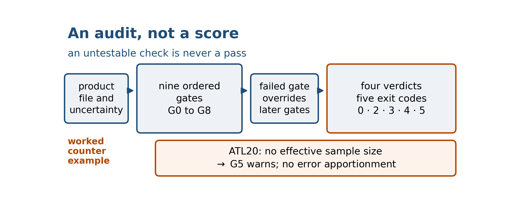

# ice-identifiability

  

A sea-ice thickness product ships a declared uncertainty. Before that number enters
an error budget, two things must hold: the declared quantity must be the one the
product delivers, and the validation reference must be independent of it. This
toolkit answers both and, when it cannot, says so — a gate that cannot be evaluated
is never a pass.

*The three-state protocol: pass, fail, and not testable.*

## What it settles

| quantity | value |
|---|---|
| gate states | pass / fail / **not testable** |
| synthetic battery | five inputs return codes 0, 0, 2, 2, 3 |
| regression tests | 29 |
| one archive product | assessable on its declared posterior channel, refused on its freeboard channel (ratio 0.053 at 80°N+) |

## Contents

    src/ice_identifiability/   the package
    examples/                  runnable examples, synthetic fixture, and data/
    tests/                     29 tests, including the gate regressions
    scripts/, pyproject.toml, requirements-lock.txt

## Quick start

    pip install -e .
    python -m pytest tests -q                  # 29 tests
    python examples/gate_calibration.py        # the gate matrix
    python examples/discriminate.py            # A/B discrimination on the fixture
    python examples/bootstrap_ci.py            # interval on the estimand

## The paper

*Auditing the testability of declared sea-ice thickness uncertainty* — submitted to
**Environmental Modelling & Software**. The software-availability section of the
paper lists the same fields this README describes.

## Licence and citation

MIT (`LICENSE`); the synthetic fixtures under `examples/data/` are CC BY 4.0
(`DATA_LICENSE`). Cite the article and this repository — see `CITATION.cff`.

---
[中文说明](README.zh-CN.md)
