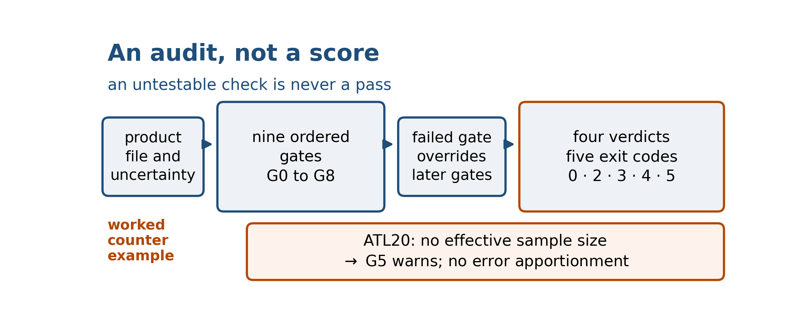

# ice-identifiability（海冰厚度不确定度可检验性）

  
  

  

海冰厚度产品都附带一个声明不确定度。这个数字进入误差预算之前，必须先确认两件事：声明的量是否
就是产品实际交付的量，以及验证参考是否独立于它。本工具包回答这两个问题；无法回答时它会明说——
**无法评估的闸门绝不能算通过**。

*三态协议：通过、不通过、不可检验。*

## 它确定了什么

| 量 | 数值 |
|---|---|
| 闸门状态 | 通过 / 不通过 / **不可检验** |
| 合成测试组 | 五个输入分别返回代码 0、0、2、2、3 |
| 回归测试 | 29 个 |
| 一个真实档案产品 | 在其声明的后验通道上可评估，在自由板通道上被拒（80°N 以北比值 0.053） |

## 目录

    src/ice_identifiability/   包本体
    examples/                  可运行示例、合成夹具与 data/
    tests/                     29 个测试，含闸门回归
    scripts/, pyproject.toml, requirements-lock.txt

## 快速开始

    pip install -e .
    python -m pytest tests -q                  # 29 个测试
    python examples/gate_calibration.py        # 闸门矩阵
    python examples/discriminate.py            # 在夹具上做 A/B 判别
    python examples/bootstrap_ci.py            # 估计量的区间

## 对应论文

*Auditing the testability of declared sea-ice thickness uncertainty*，拟投
**Environmental Modelling & Software**。论文的软件可用性小节与本 README 的字段一一对应。

## 许可与引用

MIT（`LICENSE`）；`examples/data/` 下的合成夹具为 CC BY 4.0（`DATA_LICENSE`）。
引用见 `CITATION.cff`。

---
[English](README.md)
